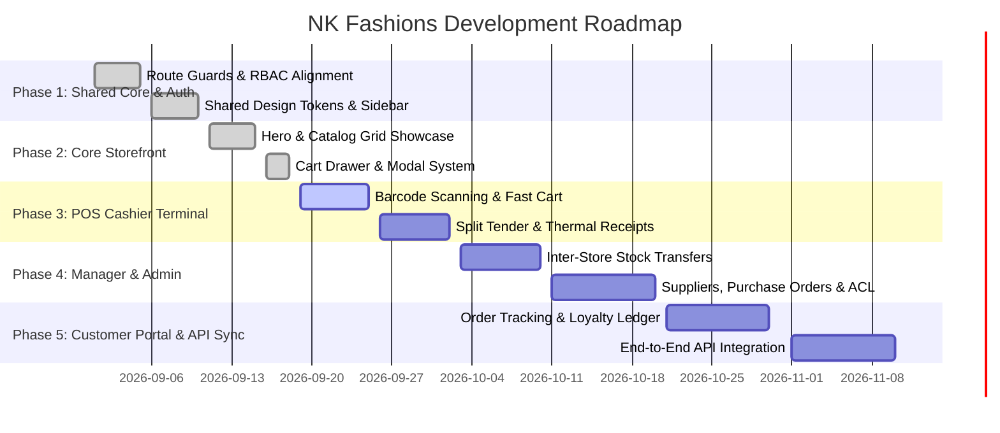

# NK Fashions — Retail Management Platform & E-Commerce Architecture Plan

## 1. Executive Summary & Vision

**NK Fashions** is an enterprise multi-channel retail management ecosystem integrating a public high-conversion e-commerce storefront, an ultra-fast in-store Point-of-Sale (POS) cashier terminal, a localized store manager portal, a personalized customer membership hub, and a centralized system administration control center.

The architecture is built on **Angular (Standalone Components, Signals, SCSS, RxJS)** connecting to a high-performance **.NET 8+ C# Web API** backend.

---

## 2. Unified Role-Based Access & Routing Matrix

The system provides 5 role-based contexts protected by authentication guards, section entry guards, and granular role permissions (`RoleGuard`, `PageGuard`, `RoleRedirectGuard`):

| Role | Route Prefix | Target Persona | Key Capabilities |
| :--- | :--- | :--- | :--- |
| **Public Storefront** | `/`, `/landing`, `/shop`, `/product/:id`, `/cart`, `/checkout` | Guests & Online Shoppers | Product browsing, faceted filtering, dynamic cart drawer, voucher discounts, guest/user checkout. |
| **Registered Customer** | `/account` (`/hospital-staff` legacy alias) | Verified Club Members | Order timeline tracking, saved wishlist, multi-address management, loyalty points ledger. |
| **POS Cashier / Operator**| `/pos` (`/staff` legacy alias) | Cashiers & Floor Staff | Barcode scanner input, speed-keys, split payments (Cash/Card/UPI), order parking/held carts, thermal receipt printing. |
| **Store Manager** | `/manager` (`/leader` legacy alias) | Store Supervisors | Local store inventory tracking, inter-branch stock transfers, cashier drawer reconciliation, shift activity logs. |
| **System Administrator** | `/admin` | Head Office & Operations | Multi-store & warehouse locations, global catalog & variant SKU matrix, staff credentials, purchase orders, audit trails. |

---

## 3. Module & Feature Specifications

### 3.1 Public E-Commerce Storefront (`src/app/pages/common/landing/` & Storefront Extensions)

* **Hero Showcase & Curated Collections:**
  * Dynamic banners highlighting seasonal promotions (Festive Sarees, Designer Kurta Sets, Premium Cotton Polos, Couple Sets).
  * Category navigation tiles with responsive imagery and quick-jump filters.
* **Product Catalog & Search:**
  * Live instant search with debounce for keyword and SKU queries.
  * Faceted filters: Category (Saree, Men's Ethnic, Casual, Couple Sets), Price Range Slider, Size, Color, In-Stock only.
  * Product card interactions: Quick View modal, hover secondary image swap, one-click add to cart, and wishlist toggle.
* **Product Details View (`/product/:slug`):**
  * High-resolution image zoom and thumbnail gallery.
  * Dynamic variant selector (Color, Size) with live price update and SKU stock availability indicator.
  * Fabric & Care instructions, size guide modal, customer reviews and star ratings.
* **Shopping Cart & Checkout Flow:**
  * Slide-out persistent Cart Drawer with live subtotal calculation, free shipping threshold progress bar, and item quantity controls.
  * Checkout page with address selection/postcode autofill, promo code verification, payment gateway integration, and instant order confirmation.

---

### 3.2 POS Cashier Terminal (`src/app/pages/cashier/terminal/`)

Designed for speed, high transaction volume, and keyboard/barcode scanner accessibility:

* **Barcode Scanner & Fast Lookup:**
  * Hardware USB/Bluetooth barcode scanner support (auto-focus enter-key listener).
  * Quick-touch item grid categorized by high-velocity products.
* **Active Cart & Transaction Operations:**
  * Real-time line item editing: quantity adjustments, line discounts (fixed amount / percentage), and removal.
  * Customer association: Quick lookup by phone number/name or default to "Walk-in Customer".
  * Loyalty points redemption toggle directly inside checkout drawer.
* **Split & Multi-tender Payments:**
  * Tender modes: Cash (with exact change calculator), Credit/Debit Card, UPI / QR Scan, Store Credit / Loyalty.
* **Held Sales / Parked Orders:**
  * Hold/suspend current cart to serve another customer and resume later with zero data loss.
* **Receipts & Returns:**
  * Direct thermal 80mm / 58mm receipt layout formatting.
  * Fast order lookup for processing item returns, exchanges, and partial refunds with manager override.

---

### 3.3 Store Manager Portal (`src/app/pages/manager/dashboard/`)

Equips store supervisors with local store visibility and operational controls:

* **Local Stock Oversight:**
  * Real-time physical, reserved, and available stock levels for the assigned branch.
  * Low-stock warnings and reorder trigger notifications.
* **Inter-Store Stock Transfers:**
  * Inbound shipment receiving with discrepancy reporting.
  * Outbound stock transfer requests to central warehouse or other retail branches.
* **Cashier Logs & Shift Audits:**
  * Real-time cashier activity log (price overrides, drawer openings, suspended carts, refunds).
  * Shift opening/closing balance declaration and drawer reconciliation.

---

### 3.4 Customer Account & Membership Hub (`src/app/pages/customer/portal/`)

Self-service portal for registered shoppers:

* **Order History & Delivery Tracking:**
  * Detailed order timeline: `Placed` $\to$ `Confirmed` $\to$ `Dispatched` $\to$ `Out for Delivery` $\to$ `Delivered`.
  * Invoice PDF download and parcel courier tracking link integration.
* **Wishlist Management:**
  * Visual collection of saved favorite items with single-click "Move to Cart" action.
* **Address Book:**
  * Multiple saved delivery and billing addresses with default tag and postal code autofill.
* **NK Loyalty Club Ledger:**
  * Tier status badge (Silver, Gold, Platinum).
  * Current points balance with a transaction ledger (points earned per purchase, points redeemed).

---

### 3.5 System Administrator Control Center (`src/app/pages/admin/dashboard/`)

Central operational cockpit for business management:

* **Executive Analytics & KPI Dashboard:**
  * Multi-store revenue comparison, top-selling SKUs, inventory gross margins, and daily sales metrics.
* **Store Locations & Warehouses:**
  * Management of physical retail outlets and fulfillment warehouses (codes, tax GSTINs, addresses, geo-coordinates).
* **Catalog & Master Variant Matrix:**
  * Hierarchy: Categories $\to$ Subcategories $\to$ Master Products $\to$ SKUs / Variants.
  * Attribute management: Colors, Sizes, Fabrics, HSN/Tax Codes, Standard Cost, Retail Price.
* **Suppliers & Purchase Orders (PO):**
  * Vendor registry and contact management.
  * Purchase order wizard: Create PO $\to$ Approve $\to$ Receive Goods $\to$ Auto-increment warehouse inventory.
* **Staff & RBAC Security:**
  * User credentials, assigned roles (`Admin`, `Manager`, `POS Cashier`, `Warehouse Staff`), and store bindings.
* **Comprehensive Audit Trail:**
  * Immutable event log capturing all critical administrative actions (price changes, manual stock adjustments, refunds, role updates).

---

## 4. Domain Data Model & Interface Mapping

```typescript
// Core Data Models Overview

// 1. Store / Warehouse Location
export interface StoreLocation {
  id: string;
  code: string;
  name: string;
  type: 'Store' | 'Warehouse';
  address: string;
  phone: string;
  isActive: boolean;
}

// 2. Product Master & Variant
export interface Product {
  id: string;
  code: string;
  name: string;
  brand: string;
  categoryId: string;
  categoryName: string;
  description: string;
  basePrice: number;
  images: string[];
  isActive: boolean;
  variants: ProductVariant[];
}

export interface ProductVariant {
  id: string;
  productId: string;
  sku: string;
  barcode: string;
  size: string;
  color: string;
  fabric?: string;
  price: number;
  costPrice: number;
  stockQuantity: number;
}

// 3. Multi-Store Inventory Level
export interface InventoryItem {
  id: string;
  locationId: string;
  locationName: string;
  variantId: string;
  sku: string;
  productName: string;
  physicalQty: number;
  reservedQty: number;
  availableQty: number;
  reorderPoint: number;
}

// 4. Orders & Sales
export interface Order {
  id: string;
  orderNumber: string;
  customerId?: string;
  customerName: string;
  customerPhone?: string;
  locationId: string;
  channel: 'Online' | 'POS';
  status: 'Pending' | 'Processing' | 'Shipped' | 'Delivered' | 'Cancelled';
  paymentStatus: 'Paid' | 'Unpaid' | 'Refunded';
  paymentMethod: 'Cash' | 'Card' | 'UPI' | 'Split';
  subtotal: number;
  discountAmount: number;
  taxAmount: number;
  totalAmount: number;
  items: OrderItem[];
  createdAt: string;
}

export interface OrderItem {
  id: string;
  orderId: string;
  variantId: string;
  productName: string;
  sku: string;
  unitPrice: number;
  quantity: number;
  discount: number;
  totalPrice: number;
}

// 5. Stock Transfer
export interface StockTransfer {
  id: string;
  transferNumber: string;
  fromLocationId: string;
  toLocationId: string;
  variantId: string;
  productName: string;
  sku: string;
  quantity: number;
  status: 'Draft' | 'InTransit' | 'Received' | 'Rejected';
  requestedBy: string;
  createdAt: string;
}
```

---

## 5. Implementation & Delivery Roadmap



---

## 6. Verification & Quality Assurance

* **Unit & Component Testing:** Validate reactive state, cart arithmetic (subtotals, discounts, taxes), and barcode scanner listeners.
* **RBAC & Guard Testing:** Verify that unauthenticated or unauthorized users cannot access restricted `/admin`, `/manager`, or `/pos` routes.
* **Responsive Viewport Testing:** Test mobile storefront responsiveness and desktop POS wide-screen keyboard workflows.
* **API Health Check Sync:** Real-time ping to backend `/health-check` service to ensure zero-downtime microservice connectivity.
